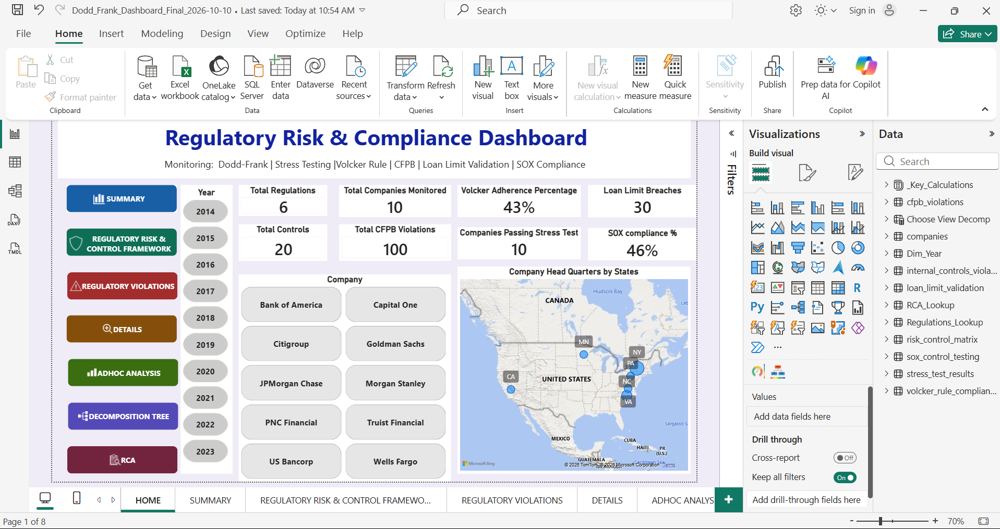
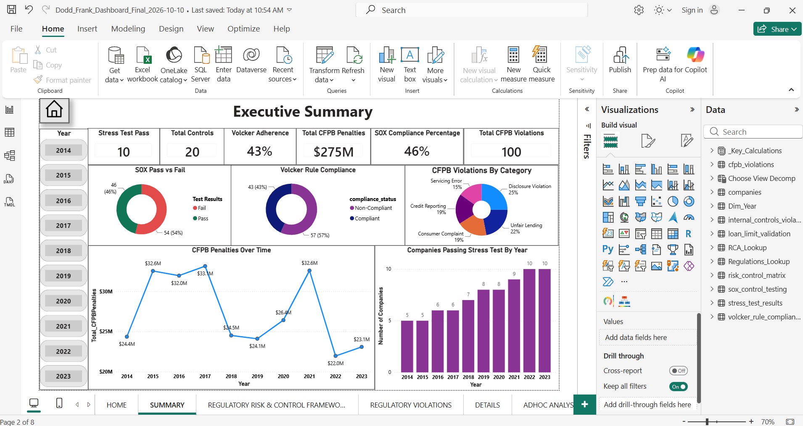
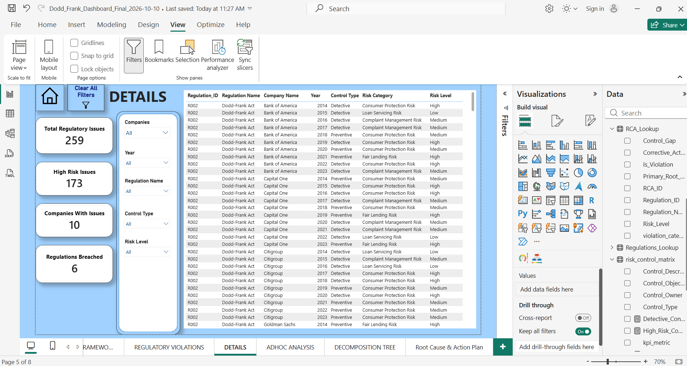

# Regulatory Risk & Compliance Intelligence Dashboard (Power BI)

An 8-page Power BI dashboard that monitors regulatory risk and control effectiveness across **10 major U.S. banks (2014–2023)** and **6 regulatory areas**, from violations and penalties down to root cause and corrective action.

**Tools:** Power BI Desktop · DAX · Power Query · SQL Server (SSMS) · Star-schema data modeling

> **Data note:** This project uses a **synthetic (AI-generated) dataset** built to resemble regulatory data for CFPB, DFAST stress testing, the Volcker Rule, SOX and loan limits. Bank names are real, but all violations, penalties, amounts and dates are **simulated for demonstration only** and do not represent actual enforcement records or the performance of any institution.

---

## Business Questions Answered

1. Which banks carry the highest regulatory exposure, and under which regulations?
2. Are penalties concentrated in a few banks (80/20 rule) or spread across the sector?
3. Which control failures drive violations, and what is the root cause of each?
4. What corrective action closes each control gap?

---

## Regulatory Coverage

| Dashboard area | Legal source |
|---|---|
| CFPB violations & penalties | Dodd-Frank Act, **Title X** (created the CFPB) |
| Stress testing (DFAST) | Dodd-Frank Act, **Title I, Section 165** |
| Volcker Rule | Dodd-Frank Act, **Title VI, Section 619** |
| SOX control testing | **Sarbanes-Oxley Act of 2002** (Section 404) |
| Loan limit validation | FHFA conforming loan limits (HERA 2008) |
| Enterprise compliance | Internal controls framework |

---

## Data Pipeline

```
CSV source files → SQL Server (database: DoddFrank_Project) → Power BI (Power Query) → Star-schema model → DAX measures → Report
```

- Tables are created with `CREATE TABLE` scripts (see `/sql`) and loaded into SQL Server.
- Power Query adds risk-level mapping tables and standardizes Regulation IDs and names.
- Data quality checks: row counts and null checks after each load.

---

## Data Model

**Fact tables (6):** `cfpb_violations`, `sox_control_testing`, `volcker_rule_compliance`, `stress_test_results`, `loan_limit_validation`, `internal_controls_violations`

**Dimension tables:** `companies`, `Dim_Year`, `RCA_Lookup`, `risk_control_matrix`, `Regulations_Lookup`

**Design decisions**
- **`Dim_Year`** has an active relationship to every fact table, so one Year slicer filters the entire report. No `TREATAS` workarounds are needed.
- **`RCA_Lookup` is the hub:** every fact table links to it on `RCA_ID`, which ties each violation to a root cause, control gap and corrective action.
- **`risk_control_matrix`** (20 controls) links only to `RCA_Lookup` (1:1). This avoids ambiguous filter paths.
- **`_Key_Calculations`** holds all report-level measures.


---

## Key DAX Measures

```dax
-- Cross-regulation issue count used on the Details page
Total_Regulatory_Issues =
    [Total Violations]                 -- CFPB violations
  + [Sox_Fail_count]                   -- SOX control test failures
  + [Volcker_NonCompliant_count]       -- Volcker non-compliant trades
  + [companies_failed]                 -- stress test failures
  + [Loan_Limit_Breaches]              -- conforming loan limit breaches
  + CALCULATE(
        COUNTROWS(internal_controls_violations),
        internal_controls_violations[Risk_Level] = "High"
    )                                  -- high-risk internal control violations

High_Risk_Issues      = CALCULATE([Total_Regulatory_Issues], RCA_Lookup[Risk_Level] = "High")
Companies_With_Issues = COUNTROWS(FILTER(VALUES(companies[Company_name]), [Total_Regulatory_Issues] > 0))
Regulations_Breached  = COUNTROWS(FILTER(VALUES(RCA_Lookup[Regulation_Name]), [Total_Regulatory_Issues] > 0))
Heatmap_Issues        = COALESCE([Total_Regulatory_Issues], 0)

Volcker_Adherence_Percentage =
    DIVIDE(
        CALCULATE(COUNTROWS(volcker_rule_compliance),
                  volcker_rule_compliance[compliance_status] = "Compliant"),
        COUNTROWS(volcker_rule_compliance)
    )
```

---

## Report Pages

| # | Page | What it shows |
|---|---|---|
| 1 | **Home** | Navigation hub, headline KPIs, bank headquarters map |
| 2 | **Summary** | Executive KPIs: CFPB violations and penalties, SOX compliance %, Volcker adherence, stress test results, trends by year |
| 3 | **Regulatory Risk & Control Framework** | 20-control Risk & Control Matrix: preventive vs detective controls, high-risk controls, controls by regulation |
| 4 | **Regulatory Violations** | CFPB violations by category, penalties by bank, SOX failures by severity, Volcker non-compliance |
| 5 | **Details** | Cross-regulation issue table with 5 slicers and 4 KPI cards (total issues, high-risk issues, companies, regulations breached) |
| 6 | **Adhoc Analysis** | Pareto (80/20) of CFPB penalties, trading exposure vs Volcker adherence scatter, bank × regulation heatmap, written key insights |
| 7 | **Decomposition Tree** | Drill from total CFPB penalties to category → bank → year → root cause → control gap |
| 8 | **Root Cause & Action Plan** | 20 root causes, each with control gap and corrective action |

### Screenshots

**Home**


**Summary**


**Regulatory Risk & Control Framework**


**Regulatory Violations**


**Details**


**Adhoc Analysis**


**Decomposition Tree**


**Root Cause & Action Plan**


---

## Key Findings (within the simulated dataset)

- **CFPB penalties:** JPMorgan Chase had the highest CFPB penalties ($33.9M), 49% above Bank of America ($22.7M), the lowest.
- **Penalty spread:** It takes 8 of the 10 banks to reach 80% of total penalties, so exposure is spread across the sector rather than concentrated in a few firms.
- **Control failures:** Citigroup and PNC lead SOX failures (7 each). Goldman Sachs, Morgan Stanley, PNC and Wells Fargo lead Volcker non-compliance (7 each). Only 5 of 10 banks failed a stress test.
- **Root-cause example:** Capital One's 2016 Credit Reporting penalties trace to Data Quality Issues, caused by weak data validation and reconciliation controls.

---

## Repository Structure

```
├── Dodd_Frank_Dashboard_Final.pbix
├── README.md
├── /data         CSV source files
├── /sql          CREATE TABLE scripts
└── /Screenshots  one image per page + model view
```

---

## Future Enhancements

- Resolution Plans (Dodd-Frank Title I, Section 165(d)) as a seventh regulatory area
- Automated SOX control testing in Python against the SQL Server tables
- Scheduled refresh through the Power BI Service

---

**Author:** Sunita Bulusu · Operational Risk & Controls · Power BI · SQL
